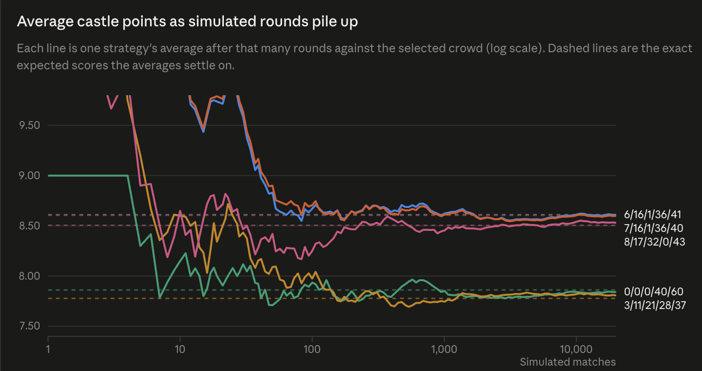
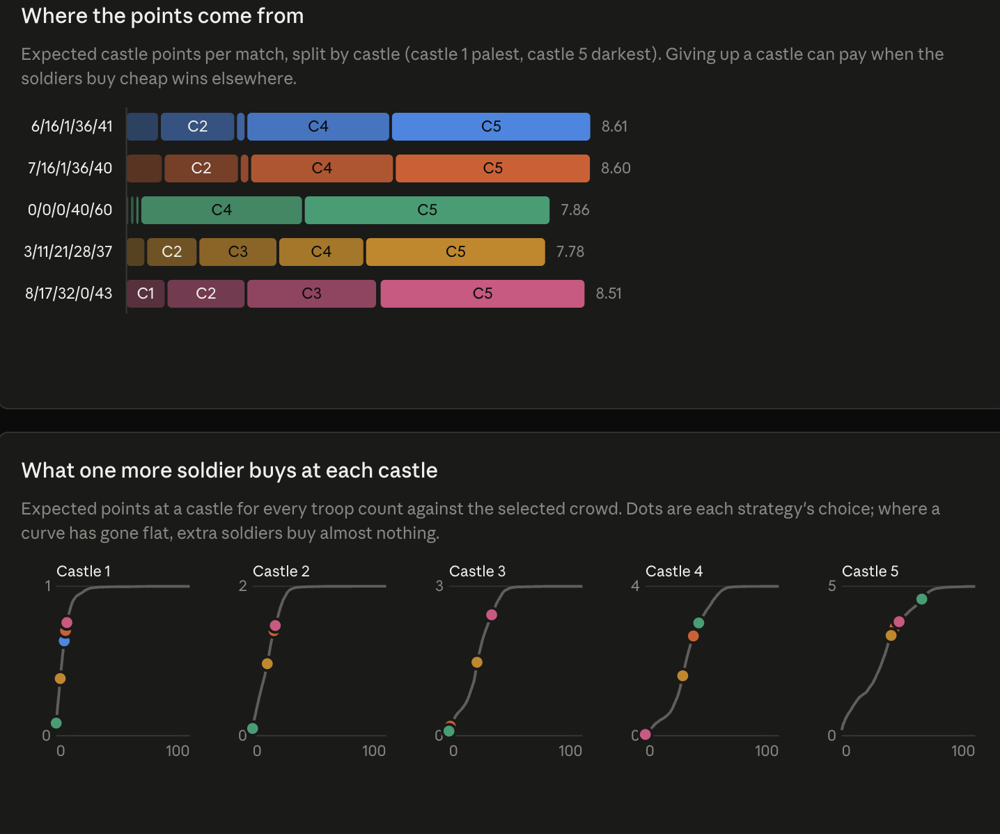
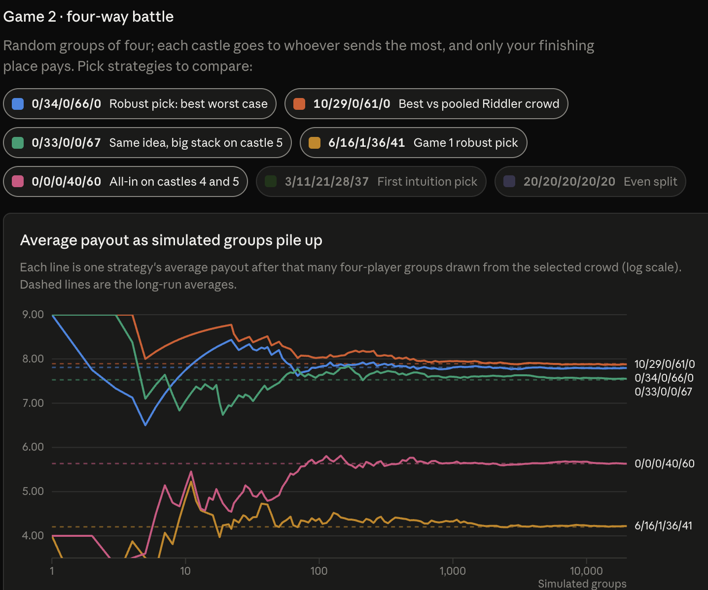
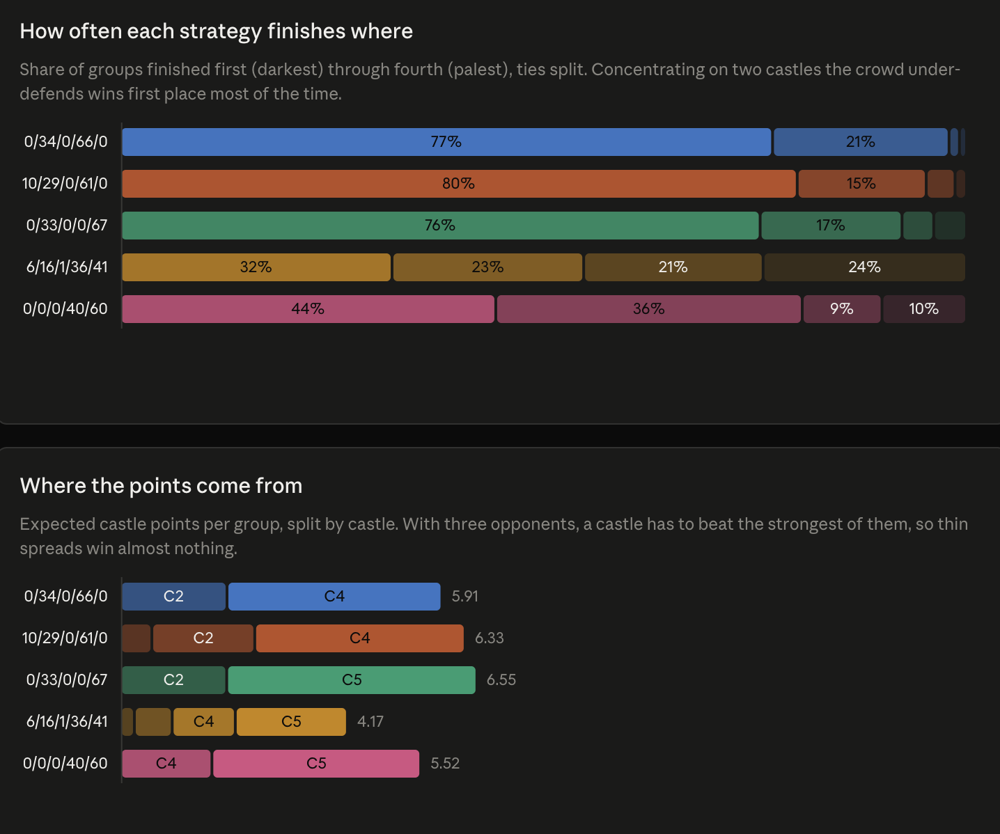

# 5-castle Colonel Blotto

Each player splits 100 soldiers over 5 castles worth 1–5 points. Two scoring rules are solved:

- **Game 1:** head to head. Your score is your average castle points against every other entry.
- **Game 2:** random groups of 4. Your finishing place pays 9 / 4 / 2 / 0.

Opponents are modelled from the 5,405 entries to FiveThirtyEight's Riddler castle contests.

## Results

| Game | Allocation (castles 1–5) | Average regret | Worst regret |
|---|---|---|---|
| 1 | **6 / 16 / 1 / 36 / 41** | 0.13 | 0.34 |
| 1, if many players best-respond | 8 / 17 / 32 / 0 / 43 | 0.31 | 0.63 (all 16 crowds) |
| 2 | **0 / 34 / 0 / 66 / 0** | 0.30 | 1.01 (all 16 crowds) |

Regret is the best score possible against a crowd minus the allocation's score against it. The tests use 12 crowds built from the Riddler data, plus 4 crowds in which some players best-respond to the others. Unless marked "all 16 crowds", regret is over the 12 data crowds.

**Game 1: give up castle 3.** Riddler players load the middle castles. About 40 soldiers each on castles 4 and 5 beats most of them, and 22 soldiers buy castles 1 and 2 cheaply. Against the pooled crowd this scores 8.61 points per match. All-in on 4 and 5 (0/0/0/40/60) scores 7.86. Moving 23 of its soldiers from castles 4–5 to castles 1–3 loses 1.21 points on 4–5 and gains 1.96 on 1–3.





**Game 2: take two castles outright.** A castle must beat the largest of three opponents, so spread allocations win almost nothing. 0/34/0/66/0 wins castles 2 and 4 in about 98% of groups. That gives about 6 points, which places first 77% of the time because the remaining 9 points are split three ways. The Game 1 pick scores 4.2 here, against 7.8.





When some players best-respond, the Game 2 best response alternates between stacking castle 4 and stacking castle 5. 0/34/0/66/0 is the choice with the smallest worst-case loss across those crowds.

## Method

| Stage | What it does | Check |
|---|---|---|
| 1 `blotto/data.py` | Load and validate all 5 Riddler rounds | All rows valid |
| 2 `stage2_validate_riddler.py` | Scoring engine | Matches an exact-fraction reference; reproduces the round-2 winner's 81.0% win rate |
| 3 `blotto/transfer.py` | Map 10- and 13-castle entries to 5 castles (pair merge, value CDF, round-number variant) | Hand-worked cases |
| 4a `stage4_game1.py` | Game 1: score all 4,598,126 allocations exactly | Dynamic program finds the same optimum |
| 4b `stage4_game2.py` | Game 2: Monte Carlo search over all allocations, then hill climbing | Matches exact enumeration on a small crowd |
| 5–6 `stage5_*.py`, `stage6_*.py` | Regret across all 16 crowds | Fresh simulation samples for the final scores |
| 7 `stage7_figure_data.py` | Data behind the figures | Running averages converge to the expected scores |

All sampling uses fixed seeds. In Game 2 every candidate is scored on the same simulated groups.

## Run

```bash
pip install -r requirements.txt
python -m pytest -q tests     # 20 tests
python run_all.py             # about 35 minutes on 2 cores; writes results/
```

## Limits

- The 5-castle crowd is inferred from 10- and 13-castle play, which is why each allocation is checked against 16 different crowds.
- Game 1 results are exact. Game 2 results come from a search and are not proven optimal.

## Data and license

Data: [fivethirtyeight/data/riddler-castles](https://github.com/fivethirtyeight/data/tree/master/riddler-castles). It is downloaded at run time and not included here; see that repo for its license. Code: MIT.
